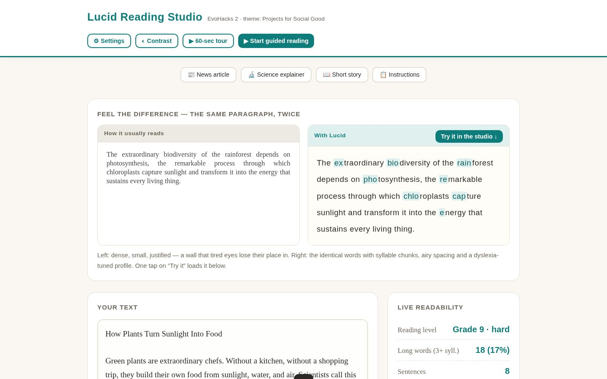

# Lucid Reading Studio

**Free, offline reading support for dyslexic readers. Social good for the 1 in 5.**

Built for **EvoHacks 2** (Nov 21–22, 2026) — theme: *Projects for Social Good*.

> One in five readers shows dyslexic traits — "perhaps as many as 15–20% of the
> population" have some symptoms of dyslexia (International Dyslexia Association,
> *Dyslexia Basics*, dyslexiaida.org/dyslexia-basics) — and the families hit
> hardest are those without money for tutors or specialist software. Lucid gives
> them a real reading tool tonight: free forever, no account, no tracking, works
> offline.

**Try it: open `index.html` in any browser.** That's the whole installation —
one HTML file, zero dependencies, zero build step, no server.

| The problem, visible | The engine, proven | A word becomes a lesson |
|---|---|---|
|  |  |  |

## What it does

- **Feel the difference first** — a before/after panel shows the identical
  paragraph twice: dense and justified (how it usually reads) vs. syllable-chunked
  and airy (after Lucid). One tap loads it into the studio.
- **Adapt any text** — paste an article, homework, or a recipe (4 samples included),
  and every long word is split into syllables by a rule-based phonics engine
  (onset maximization, digraph protection, curated exceptions — all readable in the source).
- **Reading tools that target real struggles** — sentence-start highlights, focus line
  (▲▼ keys or auto-advance), fatigue veil that hides upcoming lines, airy spacing,
  four font profiles (Lexend-style, OpenDyslexic-style, Verdana, Georgia), and a
  high-contrast dark mode.
- **Read-aloud karaoke** — the current line is spoken word-by-word with each word
  highlighted as it's read (falls back to timed highlighting on browsers with no voices).
- **Word Workshop** — tap any highlighted word: syllable chunks, tappable phoneme
  sounds, a plain-language definition from an offline dictionary, and live
  readability stats (Flesch–Kincaid).
- **Spelling drill with spaced review** — type each missing syllable, hear it
  spoken back; finished drills save to *My Words* with a practice-progress
  level (learning → practicing → mastered) and a **spaced-review schedule**:
  tomorrow → 3 → 7 → 14 days, with words due for review flagged ⏰ and sorted
  first. After each drill the app names *where* in the word the slips
  happened (first chunk / middle / ending). Exportable as CSV, browser-only.
- **Comprehension check** — auto-builds a 5-question fill-in-the-word quiz
  from the loaded text, fully offline — framed as practice feedback, not an
  assessment.
- **Reading-pace timer** — time a read-through, see words-per-minute and a
  sparkline of your pace history (all local). Practice tracking, not a
  diagnosis.
- **Backup & restore** — one click exports every word, schedule and pace
  reading as JSON; import restores it on any device.
- **Engine proof** — press "Run 16 tests" in the app: the live syllabifier verifies
  itself in the page, same suite as `tests.js`. Don't take our word for it.
- **Session panel** — lines read, words explored, drills finished, syllable accuracy:
  evidence of use, not a score.
- **Guided tour** — press "60-sec tour" for a 10-stop walk of every feature.
- **Everything local** — no server, no API keys, no tracking, works offline after
  the first load. Print-friendly (🖨 prints the adapted page only).
  Screen-reader basics: skip link, aria-live feedback on drills and toasts,
  aria-pressed tool states.

## Why transparent tech (no LLM)

Every syllable split follows visible JavaScript rules that judges and teachers can
read and verify — and run tests against, in the page or in Node. Speech uses the
browser's built-in Web Speech API. Nothing is sent anywhere.

## Run

```sh
# no install, no build — just open it
open index.html          # macOS
xdg-open index.html      # Linux
```

Or serve it (optional):

```sh
python3 -m http.server 8080   # then visit http://localhost:8080
```

## Test

```sh
node tests.js          # 16/16 syllabifier tests
```

Or press **▶ Run 16 tests** inside the app — the same suite runs against the
live page engine.

## Verified, not just claimed

Beyond the unit tests, we measured the engine against independent references
on **8,892 unseen words** (the 10,000 most frequent English words):

- **81.4% syllable-count agreement with CMUdict phonetics** (75.4% before a
  silent-e rule fix the audit itself uncovered); 68.0% with pyphen's
  orthographic hyphenation — see [`audit/`](audit/) for method, scripts,
  raw results and documented failure classes.
- **Offline verified two ways**: a static scan finds zero `fetch`/XHR/network
  references in the source, and a live browser session interacting with every
  feature recorded **zero network requests** (`performance.getEntriesByType`).
- **Keyboard-verified in a real browser**: tab order starts at the skip link;
  ESC closes the tour, the settings `<dialog>`, and the Word Workshop card;
  ▲▼ keys move the focus line; all icon buttons carry labels; drill and toast
  feedback use `aria-live`.
- **Every feature exercised in an automated 25-check browser suite**: legacy
  flows (BA panel, workshop, drill, karaoke, tour, 16/16 in-page tests) plus
  the new comprehension quiz, spaced-review drill scheduling, pace timer +
  history, backup wiring, and old-data migration — all green, zero console
  errors, zero network requests.
- **PWA offline path**: when hosted, a 40-line service worker (network-first,
  versioned cache) makes the app work with no connection after first load
  and installable via `manifest.webmanifest` — while the single-file
  `file://` build stays untouched.

## Tech

Single HTML file: vanilla HTML/CSS/JS, Web Speech API (progressive — the app works
without it), localStorage, plus an optional 40-line service worker + web manifest
for install/offline when hosted. No frameworks, no dependencies, no build step.
Tested in Chromium; responsive to 390px phones.

## Honest limits

- The offline dictionary is small (~300 words); unknown words still get syllables
  and phonemes, but no definition.
- Syllabification is rule-based English, not perfect phonology: **measured at
  81.4% syllable-count agreement with CMUdict phonetics on 8,892 unseen words**
  (audit in [`audit/`](audit/), including failure classes). Known weak spots:
  "-ed" endings, unstressed vowels ("business"), short-vowel VCV words
  ("manage"). The exception list grows with real usage.
- "Mastery" in *My Words* means **practice progress** on a spaced schedule
  (fixed 1/3/7/14-day intervals, not a full adaptive algorithm), not a validated
  learning outcome — we phrase it carefully on purpose.
- The comprehension check is auto-generated cloze from the text itself: useful
  practice feedback, not a validated reading assessment.
- Phonemes are rule-based approximations, not IPA-exact transcription.
- Read-aloud highlighting depends on the browser's voices; it degrades gracefully.
- Screen-reader support covers core flows (navigation, drill feedback), not full parity.

## EvoHacks 2 disclosure

Everything in this repo was built during the Nov 21–22, 2026 event window.
The syllabification engine, all UI, tools, drills, tour, session tracking,
before/after view, in-app test runner, and read-aloud karaoke were written at the
hackathon. The unseen-word audit, the silent-e rule it uncovered, and the
ESC-to-close accessibility fix also happened during the event, as did the
round-two upgrades (spaced review, comprehension check, pace timer, backup /
restore, service worker + manifest). No pre-existing project code was used.
