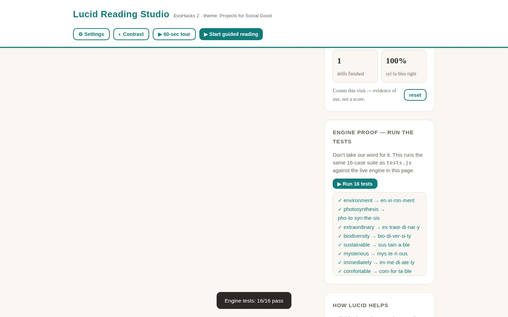
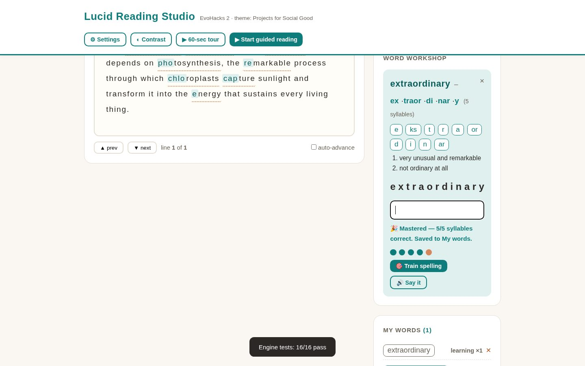

# Lucid Reading Studio

**Free, offline reading support for dyslexic readers. Social good for the 1 in 5.**

Built for **EvoHacks 2** (Nov 21–22, 2026) — theme: *Projects for Social Good*.

> One in five readers shows dyslexic traits, and the families hit hardest are those
> without money for tutors or specialist software. Lucid gives them a real reading
> tool tonight: free forever, no account, no tracking, works offline.

**Try it: open `index.html` in any browser.** That's the whole installation —
one HTML file, zero dependencies, zero build step, no server.

| The problem, visible | The engine, proven | A word becomes a lesson |
|---|---|---|
|  |  |  |

## What it does

- **Feel the difference first** — a before/after panel shows the identical
  paragraph twice: dense and justified (how it usually reads) vs. syllable-chunked
  and airy (after Lucid). One tap loads it into the studio.
- **Adapt any text** — paste an article, homework, or a recipe (4 samples included),
  and every long word is split into syllables by a rule-based phonics engine
  (onset maximization, digraph protection, curated exceptions — all readable in the source).
- **Reading tools that target real struggles** — sentence-start highlights, focus line
  (▲▼ keys or auto-advance), fatigue veil that hides upcoming lines, airy spacing,
  four font profiles (Lexend-style, OpenDyslexic-style, Verdana, Georgia), and a
  high-contrast dark mode.
- **Read-aloud karaoke** — the current line is spoken word-by-word with each word
  highlighted as it's read (falls back to timed highlighting on browsers with no voices).
- **Word Workshop** — tap any highlighted word: syllable chunks, tappable phoneme
  sounds, a plain-language definition from an offline dictionary, and live
  readability stats (Flesch–Kincaid).
- **Spelling drill with mastery** — type each missing syllable, hear it spoken back;
  a perfect run celebrates, and finished drills save to *My Words* with a mastery
  level (learning → practicing → mastered at ×3). Exportable as CSV, browser-only.
- **Engine proof** — press "Run 16 tests" in the app: the live syllabifier verifies
  itself in the page, same suite as `tests.js`. Don't take our word for it.
- **Session panel** — lines read, words explored, drills finished, syllable accuracy:
  evidence of use, not a score.
- **Guided tour** — press "60-sec tour" for a 10-stop walk of every feature.
- **Everything local** — no server, no API keys, no tracking, works offline after
  the first load. Print-friendly (🖨 prints the adapted page only).
  Screen-reader basics: skip link, aria-live feedback on drills and toasts,
  aria-pressed tool states.

## Why transparent tech (no LLM)

Every syllable split follows visible JavaScript rules that judges and teachers can
read and verify — and run tests against, in the page or in Node. Speech uses the
browser's built-in Web Speech API. Nothing is sent anywhere.

## Run

```sh
# no install, no build — just open it
open index.html          # macOS
xdg-open index.html      # Linux
```

Or serve it (optional):

```sh
python3 -m http.server 8080   # then visit http://localhost:8080
```

## Test

```sh
node tests.js          # 16/16 syllabifier tests
```

Or press **▶ Run 16 tests** inside the app — the same suite runs against the
live page engine.

## Tech

Single HTML file: vanilla HTML/CSS/JS, Web Speech API (progressive — the app works
without it), localStorage. Tested in Chromium; responsive to 390px phones.

## Honest limits

- The offline dictionary is small (~300 words); unknown words still get syllables
  and phonemes, but no definition.
- Syllabification is rule-based English, not perfect phonology — strong on common
  words (16 canonical cases locked by tests), transparent when it errs. The
  exception list grows with real usage.
- Phonemes are rule-based approximations, not IPA-exact transcription.
- Read-aloud highlighting depends on the browser's voices; it degrades gracefully.
- Screen-reader support covers core flows (navigation, drill feedback), not full parity.

## EvoHacks 2 disclosure

Everything in this repo was built during the Nov 21–22, 2026 event window.
The syllabification engine, all UI, tools, drills, tour, session tracking,
before/after view, in-app test runner, and read-aloud karaoke were written at the
hackathon. No pre-existing project code was used.
